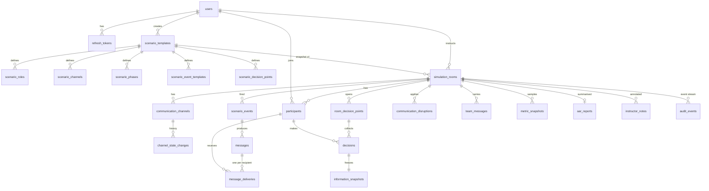

# Database design

PostgreSQL 16, SQLAlchemy 2 models in `apps/api/app/models/`, schema managed by Alembic
(`apps/api/migrations/versions/0001_initial_schema.py`). Enums are VARCHAR + CHECK
constraints. JSONB is used only for flexible payloads (targeting rules, variants, snapshots,
report payloads); frequently queried fields are relational columns.

## Core tables

| Table | Purpose / key columns |
|-------|-----------------------|
| `users` | email (unique), argon2 `password_hash`, `role` (ADMIN/INSTRUCTOR/TRAINEE), `is_active` |
| `refresh_tokens` | `token_hash` (SHA-256, unique), `family_id`, `expires_at`, `revoked_at` |
| `scenario_templates` | name, difficulty, duration, category, briefing, `objectives`, `initial_conditions` (facts timeline + fictional locations), `degradation_rules` |
| `scenario_roles` / `scenario_channels` / `scenario_phases` | per-scenario definitions; unique `(scenario_id, key)`; channels have reliability, latency, weight, `fallback_channel_key` |
| `scenario_event_templates` | event type, trigger (TIME/MANUAL/AFTER_DECISION), offset, channel, priority, source + reliability, importance weight, `fact_key`/`fact_value`, `targeting_rules`, `variants`, `effects` |
| `scenario_decision_points` | prompt, options (with hidden `truth_alignment` rubric), window, target roles, relevant fact keys |
| `simulation_rooms` | `room_code` (unique), status (LOBBY/RUNNING/PAUSED/COMPLETED/ARCHIVED), `seed`, clock fields (`started_at`, `paused_at`, `total_pause_seconds`, `sim_anchor_seconds`, `anchor_at`, `time_scale`, `final_sim_seconds`), `event_seq`, frozen `scenario_snapshot` |
| `participants` | room, user, callsign, `assigned_role`, `connection_status`, `is_ready`; unique `(room_id, user_id)` |
| `communication_channels` | live state per room; `channel_state_changes` is the append-only history used by replay |
| `scenario_events` | events that fired; partial unique index `(room_id, template_key)` prevents double firing |
| `messages` | canonical content (truth side): label (M101…), source, reliability, priority, importance, fact |
| **`message_deliveries`** | one row per (message, participant): status (PENDING/DELIVERED/DELAYED/DROPPED/ALTERED/FAILED), delivered content/fact value, `scheduled_sim_time`, `actual_delivery_sim_time`, delay, path reliability, `transformation_type`, reasons metadata, acknowledgement |
| `room_decision_points` / `decisions` | opened/closed sim times; decisions unique per `(room, participant, decision_point)`, confidence CHECK 0-100, response time |
| **`information_snapshots`** | frozen digital twin at each decision: known/pending message ids, unavailable channels, completeness, reliability, comm health, contradictions, uncertainty, full payload |
| `communication_disruptions` | type, targets (participants/channels), severity, start/end/planned end, configuration |
| `team_messages` | participant chat with `delivered_to` (blackouts exclude recipients) |
| `metric_snapshots` | periodic per-participant and team metrics (charts) |
| `aar_reports` | one per room, versioned; `report_payload`, `ai_narrative` (narrative only) |
| `instructor_notes` | timestamped (simulation time) notes |
| **`audit_events`** | append-only stream: per-room `seq` (unique), `event_type`, `payload`, `sim_time`, `visibility` (ALL/INSTRUCTOR/PARTICIPANTS), `target_participant_ids` |

## Indexes for common queries

`ix_deliveries_due (room_id, delivery_status, scheduled_sim_time)` - tick delivery scan;
`ix_deliveries_participant_time` - trainee feeds and reconstruction; `ix_messages_room_sim`;
`ix_scenario_events_room_sim`; `ix_channel_state_changes_room_sim`; `uq_audit_events_room_seq`
and `ix_audit_events_room_type`; `ix_disruptions_room_active`; FK indexes throughout.

## Integrity & immutability

- Critical writes (decision + snapshot, message + deliveries, simulation completion) run in a
  single transaction with the room row locked (`SELECT … FOR UPDATE`).
- Duplicate decisions / joins / event firings are prevented by unique constraints.
- After COMPLETED the engine rejects mutations; AAR regeneration and notes are audited.
- Rooms store a frozen scenario snapshot, so template edits never alter history.
